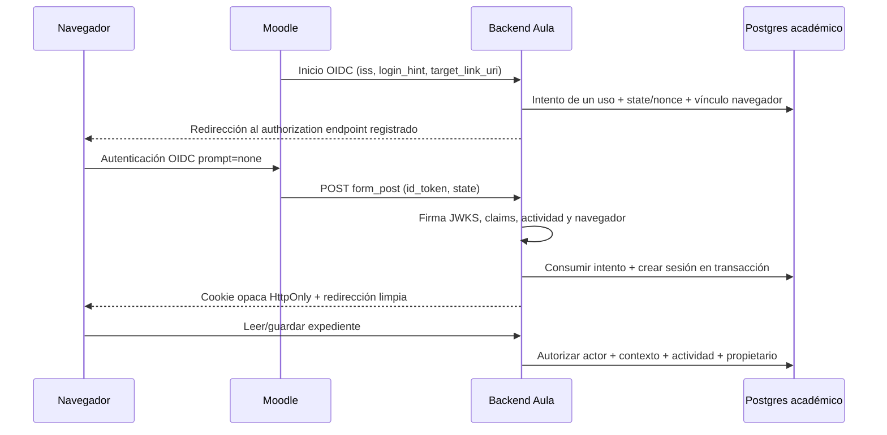

Estado actualizado: ver [lti-pilot-development.md](lti-pilot-development.md). El diseño siguiente es histórico; ahora existe backend LTI de staging probado localmente, sin despliegue ni conexión real. AGS, envío de notas y registro productivo siguen deshabilitados. No ejecutar los pasos históricos de publicación de calificaciones durante este piloto.

# MAC Aula — arquitectura propuesta (ADR-001)

Estado: diseño aprobado para implementación incremental. No existen endpoints LTI, tablas académicas de Supabase ni sesiones LTI implementados. La fase 2 añade un simulador local independiente descrito en `phase2-implementation.md`; no reemplaza la arquitectura productiva aquí propuesta.

## Decisión y límites
Mantener MAC Profesional y crear una aplicación académica independiente. Preferir proyecto Supabase académico separado para reducir radio de impacto; staging separado antes de cualquier integración real. Reutilizar componentes mediante adaptadores, conservando contratos profesionales. Backend candidato: Supabase Edge Functions + Postgres, con un origen académico/proxy que controle cookies, cabeceras y entrega HTML. Alternativa si el spike de hosting falla: backend equivalente con soporte completo de OIDC, PostgreSQL y cookies, sin trasladar autenticación a Pages.

El cliente Aula puede ser estático, pero no contendrá expedientes, tokens ni solucionarios en sus archivos. Acceder a su HTML no autoriza a leer datos: la API devolverá 401 sin sesión. Preferir cliente/API bajo el mismo origen académico para no depender de cookies de terceros ni de un token persistido en localStorage. No registrar URLs ficticias; el dominio académico debe acordarse.

## Registro y lanzamiento
Registro manual inicial con issuer exacto, client ID, deployment(s), endpoint de autorización, JWKS y token endpoint suministrados por Moodle. Solo HTTPS y destinos permitidos por configuración; no descubrir endpoints usando parámetros del navegador. Tabla de actividades autorizadas por registro/deployment/context.id/resource_link.id, con caso y versión fijados. Primer uso no debe autoautorizar cualquier actividad; el administrador activa el mapeo tras verificar IDs.

1. `/lti/login` acepta inicio GET/POST y límites de tamaño; resuelve registro por issuer/client ID y valida target_link_uri contra una lista exacta. Conserva login_hint/lti_message_hint sin tratarlos como identidad. Si hay varios client ID y no se puede resolver, rechaza.
2. Genera state/nonce y secreto de vinculación del navegador, 256 bits de entropía; guarda hashes, registro, destino y expiración corta (propuesta 5 min). Usa respuesta OIDC `scope=openid`, `response_type=id_token`, `response_mode=form_post`, `prompt=none`, redirect_uri exacto, client_id, state, nonce y hints recibidos.
3. `/lti/launch` exige POST y state vigente ligado al navegador. Verifica JWT mediante librería mantenida con versión fijada, algoritmo RS256 autorizado y kid en JWKS del registro. Ignora/rechaza jku/x5u no configurados; caché JWKS con límites, timeout y rotación controlada, sin fetch arbitrario.
4. Valida issuer exacto, audience (cadena o array), azp cuando proceda, sub no vacío, exp/iat/nbf y tolerancia acotada; nonce constante, LTI version 1.3.0, message_type LtiResourceLinkRequest, deployment permitido, target_link_uri idéntico al intento, context.id, resource_link.id y roles conocidos. Si hubo lti_deployment_id en inicio debe coincidir. No aceptar Student/Instructor por texto libre o coincidencia parcial de URI.
5. Consume state/nonce de forma atómica y crea sesión solo tras validación completa; dos POST simultáneos solo pueden crear una. Rechaza replay. No registrar id_token ni hints personales.
6. Identidad interna UUID mapeada por registro (issuer/client_id), deployment y sub validado; memberships por contexto y actividad. No usar correo, nombre o cédula; no enlazar integrantes profesionales. Ante roles ambiguos privilegiados, denegar escritura docente hasta resolver política.

Para `/lti/login` y `/lti/launch`, Moodle no envía JWT Supabase. Si se usan Edge Functions, configurar verificación de gateway apropiada solo para estos endpoints y ejecutar validación LTI propia completa; `verify_jwt=false` no constituye autenticación. API académica valida su sesión en cada operación. Primero verificar en staging soporte de form_post, cookies, HTML, proxy y cabeceras, no asumirlo por documentación general.

## Sesiones y navegación embebida
Sesión opaca de alta entropía con hash en BD, TTL propuesto 60 min y límite de inactividad a definir; revocación inmediata por tabla, rotación al relanzar. Cookie de aplicación `__Host-...`, Secure, HttpOnly, Path=/, sin Domain; protección CSRF por token y Origin exacto en operaciones de escritura. `Cache-Control: no-store`, Referrer-Policy restrictiva, CSP propia, frame-ancestors limitado al Moodle autorizado; no copiar analytics profesional.

Cookie transitoria de correlación OIDC SameSite=None; Secure para POST entre sitios. Cookie de sesión preferentemente Lax en ventana superior. Usar «nueva ventana» como modalidad inicial. Si el navegador bloquea correlación en iframe, fallar con instrucción de relanzar desde Moodle en ventana superior; nunca omitir vínculo navegador o validar solo state. No colocar tokens en query string. Si se habilita iframe posteriormente, demostrar soporte de almacenamiento y revisar LTI client-side postMessages con orígenes/ventanas exactos; no tomarlo como implementado.

## Persistencia y autorización de datos
Modelo propuesto en esquema académico no expuesto por Data API, con RLS de defensa en profundidad. Sin grants para anon/authenticated ni funciones públicas nuevas por defecto. Backend con rol limitado sin BYPASSRLS; una transacción configura actor/contexto desde sesión validada con SET LOCAL, nunca desde campos del cliente. Políticas verifican memberships actuales y relaciones completas. Si Edge/PostgREST obliga a otro patrón, ADR y pruebas de permisos antes de usarlo; service_role omite RLS y no debe ser el acceso ordinario. Pooling debe limpiar contexto entre solicitudes.

| Entidad propuesta | Claves, contenido y acceso |
|---|---|
| platforms / deployments | Registro, endpoints y estado de autorización; secretos fuera de tablas públicas. Solo administrador. |
| identities | UUID, registration/deployment/sub únicos; datos de presentación mínimos. Backend resuelve identidad. |
| contexts / memberships | Curso y actor/roles/contexto validados con fecha; docente limitado al curso/actividad asignado. Revocación y reconciliación necesarias. |
| activities | deployment + context + resource_link únicos; caso/version, fechas, scopes y lineitem AGS autorizados. |
| cases / case_versions | Contexto, evidencia, declaraciones y referencias públicas al alumno; versión inmutable al asignar. |
| case_solutions | Árbol, cronología de referencia y criterios privados; tabla y endpoint exclusivamente docentes asignados. Nunca en JSON del caso del alumno. |
| investigations / revisions | UUID, propietario, actividad, caso/version, documento, revision; guardado con control optimista y 409 ante conflicto, no sobrescribir silenciosamente. |
| submissions | Snapshot inmutable, intento y fecha; alumnos leen solo propio, docente lee ámbito asignado. |
| evaluations | Snapshot, rúbrica versionada, puntos por criterio, observaciones, revisor, estado y confirmación; alumno solo evaluación publicada. |
| grade_outbox | Evaluación confirmada, destination/lineitem, versión, estado, reintentos y respuesta sanitizada. Solo backend; unicidad evita duplicados locales. |
| launch_attempts / sessions / audit_events | Hashes, vencimiento/revocación, actor, acción, objeto, request ID. Sin JWT, claves o expediente completo en logs. |

FK compuestas o comprobación transaccional impiden enlazar expediente de un curso a actividad/caso de otro. RLS SELECT y UPDATE con USING/WITH CHECK equivalentes, prohibiendo cambiar propietario/ámbito. Validar esquema JSON, tamaños, enums, IDs, grafo acíclico y vínculos en servidor; validación cliente solo mejora UX. Adjuntos en bucket privado con URLs breves emitidas tras autorización y validación de tipo/tamaño. PDF/Excel también requieren acceso al expediente; no URLs públicas permanentes.

Contenido inicial exclusivamente simulado. Conservación, borrado, copias, región y responsables deben ser acordados por Academia antes de pilotar; no inventar plazos normativos. Separar eliminación de entregas y auditoría según política. Migraciones aditivas en staging, rollback probado y respaldo; ninguna modifica private.mac_* o integrantes. No reutilizar AES profesional: su clave está ligada a membresía y almacenamiento local; Aula necesita permisos compartidos con docentes y recuperación entre dispositivos. Cifrado en tránsito/en reposo y control de acceso son base; cifrado de aplicación requeriría gestión de claves del backend y ADR adicional.

## Evaluación y AGS
**Actualización de requisitos:** `evaluation-architecture.md` (ADR-002) sustituye el modelo exclusivamente manual por evaluación automática de competencias y supervisión por excepciones. El motor de backend combina reglas, rúbrica versionada y futura IA; hoy no hay proveedor conectado. Estados A/B/C, calibración empírica, feedback específico, reclamaciones y trazabilidad forman parte central de Aula. La publicación automática definitiva está deshabilitada; podrá diseñarse una política nueva solo tras calibración y aprobación expresa del administrador. Las referencias siguientes a confirmación docente describen el piloto y no obligan a revisar manualmente cada expediente en la arquitectura objetivo.

Rúbrica propuesta (100): evidencias 20, reconstrucción 15, árbol 35, medidas 20, informe/trazabilidad 10. Cuatro niveles por criterio: insuficiente 0%, inicial 40%, competente 75%, destacado 100% del máximo; docente elige con comentario y evidencia del expediente. Árbol: lógica causal, conjunciones, sustento y justificación, no coincidencia literal con solucionario. Medidas: jerarquía de control, vínculo causal, responsable, plazo e indicador de eficacia. Detalle en `docs/student-teacher-experience.md`.

Validaciones automáticas producen advertencias (referencias rotas, ciclos, evidencia sin fuente, medida sin indicador), nunca nota favorable. Estados: borrador → entregado → en revisión → evaluado → confirmado por docente → pendiente AGS → enviado/error. Reabrir expediente crea nuevo intento; no cambia el snapshot evaluado. Confirmar exige revisor docente autorizado, rúbrica completa, puntajes finitos dentro del rango y versión vigente.

Backend solicita access token mediante OAuth2 client_credentials y private_key_jwt firmado con clave privada custodiada fuera del repo; exp breve, jti único, audience del token endpoint según registro, scopes mínimos (`.../scope/score`; lineitem solo si se necesita crear). Publicar únicamente JWKS público con kid y rotación. Usar lineitem del claim validado y permitido, ligado a actividad; jamás aceptar URL de destino del cliente. HTTPS, host/ruta autorizados, sin redirecciones arbitrarias ni destinos privados para evitar SSRF.

Enviar scoreGiven, scoreMaximum=100, userId=sub del alumno de esa plataforma, timestamp, activityProgress=Completed, gradingProgress=FullyGraded y comentario publicado según política. Outbox transaccional ligada a confirmación; reintentos acotados para timeout/429/5xx, no duplicar confirmaciones ni anunciar éxito sin respuesta válida. Mantener historial de correcciones y serializar versiones para no enviar una nota antigua después de una nueva. AGS no garantiza una clave de idempotencia HTTP universal. Si no hay scope/lineitem, conservar evaluación y mostrar pendiente de configuración. NRPS no está incluido inicialmente: panel solo puede listar usuarios que lanzaron o fueron asignados; listado completo requeriría NRPS o provisión administrativa autorizada.

Deep Linking queda para fase posterior: mensaje LtiDeepLinkingRequest separado, roles/configuración validados, selección autorizada y LtiDeepLinkingResponse firmada con data de correlación y return URL registrada. No ofrecer selección de contenido antes de implementarlo.

## Fases y criterios de salida
1. **Auditoría**: base identificada, AGENTS, ADR, pruebas de acceso y regresiones, cambios aditivos revisables. Esta entrega.
2. **Contratos y experiencia aislada**: caso integral distinto de demo, rúbrica versionada, validadores y almacenamiento con conflicto; extracción editor/exportadores con equivalencia profesional. Staging sin alumnos reales; solucionario solo servidor.
   Ampliación de fase 2: motor determinístico separado, contrato IA independiente de proveedor, tres estados, feedback público seguro, bandeja por excepciones, evaluación formativa y pruebas adversariales. Luego dataset privado de especialistas y comparación de candidatos, sin conexión de pago no autorizada.
3. **LTI y permisos**: spike hosting/cookies; registro Moodle sandbox; JWKS/JWT/nonce/state; roles, actividad autorizada, sesiones, políticas y pruebas negativas multiusuario; AGS con confirmación. No acceso académico operativo hasta superar aislamiento.
4. **Calidad**: revisión docente, persistencia entre dispositivos, concurrencia, exportación árbol completo legible, móvil/teclado/lector, regresión profesional y pruebas con estudiante externo sin Directorio. Evidencia reproducible y revisión pedagógica.
5. **Despliegue**: parámetros reales, respaldos, dry run/rollback, observabilidad y aprobación del usuario antes de producción; piloto con un caso, luego ampliar biblioteca.

## Fuentes técnicas consultadas
- https://www.imsglobal.org/spec/lti/v1p3/ — Core.
- https://www.imsglobal.org/spec/security/v1p0/ — OIDC/JWT y servicios.
- https://www.imsglobal.org/spec/lti-ags/v2p0/ — notas y scopes.
- https://supabase.com/docs/guides/functions/auth — autenticación de funciones; cotejar configuración vigente al implementar.
- https://supabase.com/changelog — revisado el 2026-11-01; aviso de cifrados TLS antiguos para 2026-11-10 relevante a conectividad de integraciones antiguas; no motiva cambios en Profesional ahora. Endpoint .md no legible por herramienta web; usada versión HTML.
- https://docs.moodle.org/503/en/Managing_LTI_External_tools y https://docs.moodle.org/503/en/External_tool_settings — registro y contenedor. No demuestran configuración del sitio del usuario.
